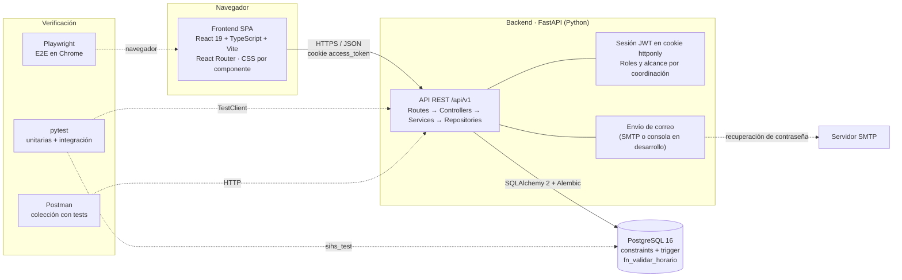
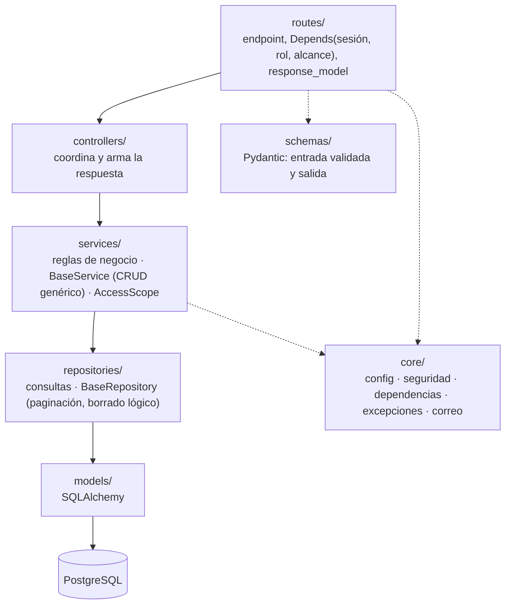
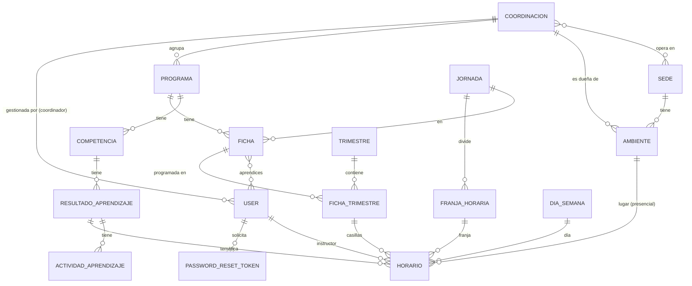
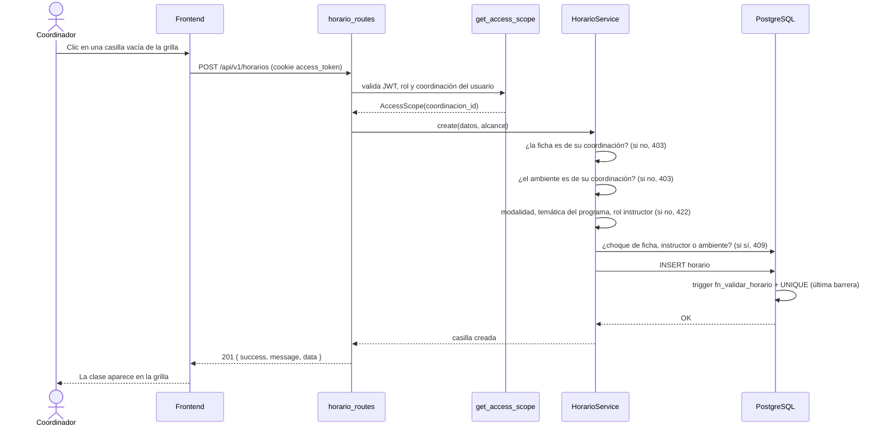

# Arquitectura de SIHS

Actualizado al cierre de T6 (noviembre de 2026). GitHub dibuja los diagramas Mermaid de este archivo.

## 1. Vista general del sistema

| Componente | Responsabilidad |
|---|---|
| Frontend (`frontend/`) | Interfaz por rol: dashboards, CRUD de gestión, grilla de horarios, "Mi horario", "Mi programa" y recuperación de contraseña. Oculta lo que el rol no puede hacer, pero **la seguridad real está en la API** |
| Backend (`backend/`) | Reglas de negocio, validación de datos, autenticación, permisos por rol y por coordinación |
| PostgreSQL | Integridad: UNIQUE contra choques de horario, CHECK de modalidad y ambiente, FK compuesta ficha-trimestre, y el trigger que exige rol instructor, temática del programa y ambiente de la misma coordinación |
| Prototipo SQL (`db_horarios/`) | Modelo inicial y carga masiva por CSV. Es la base del módulo de carga masiva de T7 |

## 2. Capas del backend

## 3. Modelo de datos (resumen)

Una **casilla de horario** se identifica por ficha-trimestre × día × franja. Tres restricciones UNIQUE impiden los choques:
- `(ficha-trimestre, día, franja)`
- `(trimestre, día, franja, instructor)`
- `(trimestre, día, franja, ambiente)`

## 4. Flujo: un coordinador programa una clase

## 5. Decisiones de arquitectura

| Decisión | Motivo |
|---|---|
| JWT en cookie **httponly** en vez de `Authorization: Bearer` desde el frontend | JavaScript no puede leer el token, lo que mitiga el robo por XSS. El navegador lo envía solo |
| UUID público + `id` entero interno | Las URLs no exponen el orden ni la cantidad de registros, y los joins internos siguen siendo rápidos |
| Reglas de horario en el servicio **y** en la BD | El servicio devuelve mensajes claros; la BD protege aunque alguien inserte por fuera de la API (seed, SQL manual) |
| `AccessScope` en `BaseService` | Un solo punto aplica el filtro por coordinación a todas las lecturas, sin repetirlo en cada endpoint |
| Borrado lógico (`is_active`) en catálogos y borrado físico en horarios | Los catálogos tienen historial; una casilla de horario eliminada debe liberar el espacio |
| Correos en minúsculas (`NormalizedEmail`) | Una persona tiene una sola cuenta, sin importar cómo escriba su correo (DEF-02) |
